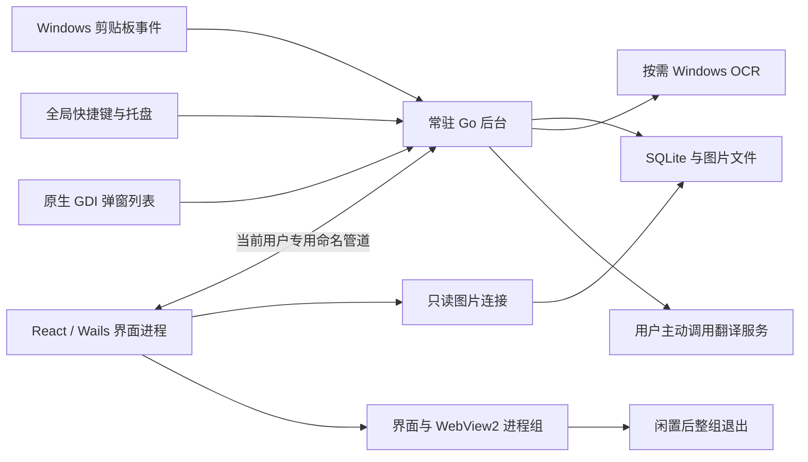

# ClipBox 架构

0.4.0 将常驻后台与界面分离；0.4.1 起日常列表改为后台进程内的原生 GDI 弹窗（无浏览器运行时），WebView2 仅用于设置、详情和识别翻译等低频页面。分发仍为一个 `ClipBox.exe`：普通启动／`--hidden` 运行后台，同一个程序通过内部 `--ui` 模式提供界面。

## 所有权

- 后台独占剪贴板监听、全局热键、托盘、自启配置、数据库写入、OCR／翻译任务和凭据。后台运行不需要启动 WebView2。
- 原生弹窗（`internal/popup`）在后台进程内绘制列表：直接调用 `App` 服务（分页查询、粘贴、置顶、删除），无 IPC 开销；隐藏是同步的，粘贴前无需等待界面确认。打开设置或详情时弹窗让位，按需启动 WebView2 界面进程。
- 界面进程只负责设置、详情、编辑、原生文件对话框和只读图片加载。界面进程的数据库连接开启 SQLite 只读模式，不能迁移或写入数据。
- 命名管道 ACL 仅允许当前 Windows 用户；另有随机会话令牌。IPC 没有 TCP 端口，内部辅助方法不在调用白名单中。
- UI API 由 `scripts/generate-uibridge.go` 从应用服务生成。前端统一通过 `src/api.ts` 导入接口，DTO 复用生成的类型。

## 界面生命周期

唤起请求默认显示后台进程内的原生弹窗（`resident.show` 列表模式），不产生任何子进程；隐藏即同步释放。打开设置（托盘或弹窗）或详情（弹窗 Space/i）时才创建 WebView2 界面进程；React 挂载并订阅事件后报告就绪，再显示窗口。设置/详情仍存在时直接显示并发送对应事件。隐藏后默认保留 60 秒，可在常规设置改为 15 秒、1 分钟、3 分钟或 10 分钟。

未保存草稿、未复制的识别／翻译结果、正在运行的任务和文件对话框会阻止自动回收。搜索和筛选状态保存在后台内存中，界面重新创建后恢复。已复制的结果允许回收。界面断开时取消其 OCR／翻译任务。

Windows Job Object 管理界面及其浏览器子进程；退出时终止并等待整个进程组，避免主界面结束后还留有 WebView2 缓存写入或后台进程。回收过程中再次唤起的请求会排队，完成后重新创建界面。复制并粘贴等待界面隐藏确认后才切换焦点。

开发构建保留单进程 Wails 热更新模式。生产生命周期和性能验收使用生产 EXE；开发模式的内存不是生产后台的内存基线。

## 模块

| 模块 | 职责 |
|---|---|
| `resident_windows.go`、`ipc_windows.go`、`ui_job_windows.go` | 后台、IPC、界面进程管理 |
| `internal/popup` | 原生 GDI 弹窗：窗口、绘制、键盘、主题与定位 |
| `ui_bridge_windows.go`、`ui_api_generated.go` | 类型化界面代理、事件与对话框 |
| `internal/storage/store.go` | 连接、迁移和保存 |
| `internal/storage/queries.go`、`search.go`、`tags.go` | 轻量列表、全文搜索、标签 |
| `internal/storage/maintenance.go`、`image_gc.go` | 维护与提交后文件回收 |
| `internal/storage/image_content.go` | 捕获与备份共用图片恢复规则 |
| `internal/clipboard`、`internal/hotkey`、`internal/tray` | Windows 系统集成 |
| `image_assets.go` | 原图二进制读取和有界预览 |
| `internal/ocr`、`internal/translation`、`text_tools.go` | 本地识别、按需翻译与取消 |
| `frontend/src/ClipItem.tsx`、`ClipDetailPanel.tsx` | 行与详情展示 |
| `useSettingsController.ts`、`Settings*.tsx` | 设置状态与分区界面 |
| `useUIActivity.ts`、`useDialogFocus.ts` | 草稿保护与键盘焦点 |

## 数据与性能约束

列表不读取完整正文，详情、复制和翻译按 ID 获取。列表排序有匹配索引，标签按需聚合并使用 O(n log n) 排序。图片哈希使用流；图片详情按行采样到最长边 1280 像素，原图仍用于复制、导出和 OCR。

记录删除与文件回收登记在同一事务中。捕获和导入使用统一的缺失图片修复规则。维护只删除明确不存在的绝对文件路径，保留旧版 base64 内容与权限／I/O 错误的数据。设置通过字段补丁合并并序列化写入；热键注册与数据库保存失败时恢复此前组合。

变更必须通过前端测试、ESLint、Prettier、TypeScript、Go 测试、`go vet`、依赖审计和生产构建。`process_lifecycle_windows_test.go` 可对生产 EXE 做独立数据目录的生命周期验收，不修改真实启动项、不注入剪贴板内容。
